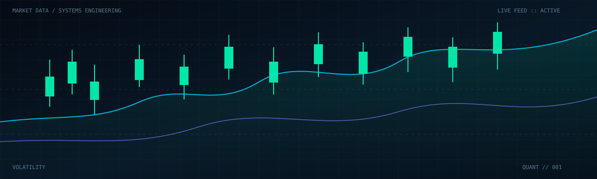

<!-- ===================================================== -->
<!-- QUANT TERMINAL PROFILE README — MUSKAN                 -->
<!-- ===================================================== -->

  

  
  
  

  <a href="https://www.linkedin.com/in/muskan-b79805328/">LINKEDIN</a> &nbsp; // &nbsp;
  <a href="https://github.com/Muskan-bit-space">GITHUB</a> &nbsp; // &nbsp;
  <a href="https://leetcode.com/u/Muskan_280706/">LEETCODE</a> &nbsp; // &nbsp;
  <a href="https://codeforces.com/profile/Muskan_2807">CODEFORCES</a>

---

<h2><code>01 / PROFILE OVERVIEW</code></h2>

Computer Science undergraduate at **Indira Gandhi Delhi Technical University for Women (IGDTUW)**, interested in building scalable backend systems, real-time applications, and data-driven software solutions.

I enjoy working with backend architectures, database optimization, REST APIs, and distributed communication systems, with hands-on experience developing full-stack applications.

**Primary Focus:** Backend Engineering | Real-Time Systems | Database Optimization

---

<h2><code>02 / TECHNICAL ARSENAL</code></h2>

| DOMAIN | TECHNOLOGIES |
|:---|:---|
| Programming | C++, C, JavaScript, Python, R |
| Backend | Node.js, Express.js, REST APIs, JWT, Socket.IO |
| Frontend | React.js |
| Databases | PostgreSQL, MongoDB, Supabase |
| Caching | Redis |
| CS Fundamentals | DSA, OOP, DBMS, OS, CN |
| Developer Tools | Git, GitHub, Postman, VS Code, Cursor |

---

<h2><code>03 / PROFESSIONAL EXPERIENCE</code></h2>

### CFEES (DRDO) — Website Development Summer Intern

`JUNE 2025 — JULY 2025`

**TECH STACK:** React.js · Node.js · Express.js · MongoDB · REST APIs

- Co-designed and developed a full-stack inventory management portal using React, Express.js, and MongoDB, handling **100–150 inventory transactions daily**.
- Implemented real-time stock synchronization using MongoDB Change Streams, improving inventory accuracy and reducing allocation delays.
- Worked on database-driven application development and REST API integration.

---

<h2><code>04 / SYSTEMS & PROJECTS</code></h2>

### [01] QUIZLY — Real-Time Multiplayer Quiz Platform

`2026` | `REAL-TIME SYSTEMS` `BACKEND ENGINEERING`

**TECH STACK:** React.js · Node.js · Express.js · PostgreSQL · Redis · Socket.IO · JWT

- Engineered a real-time multiplayer quiz platform supporting synchronized question delivery, live leaderboard updates, and concurrent gameplay for **100+ real users in each room**.
- Designed a modular Node.js and Express.js backend with stateless REST APIs, input validation, centralized error handling, and separation of concerns.
- Developed normalized PostgreSQL schemas with indexed queries and optimized data retrieval.
- Implemented Redis caching for frequently accessed quiz and leaderboard data, reducing database load by **80%**.
- Integrated JWT-based authentication and event-driven communication for real-time multiplayer sessions.
- Developed a platform adopted by multiple faculty members to create, manage, and conduct multiplayer quizzes.

---

### [02] FleetPulse — Real-Time Vehicle Telemetry & Analytics

`MSC IGDTUW HACKATHON 2025` | `DATA PROCESSING` `REAL-TIME ANALYTICS`

**TECH STACK:** Node.js · Express.js · PostgreSQL · Redis · Socket.IO · React.js

- Built a REST-based telemetry ingestion pipeline processing **500+ records per minute across 150+ vehicles**.
- Implemented real-time detection of overspeeding, low fuel, and abnormal engine conditions.
- Designed indexed PostgreSQL storage and sliding-window aggregations for time-series analytics, reducing analytical query time by **90%**.
- Integrated Redis and Socket.IO for real-time vehicle monitoring and alert streaming.
- Applied batching, indexing, connection pooling, and pre-aggregation to improve ingestion throughput and retrieval performance.

---

<h2><code>05 / PERFORMANCE METRICS</code></h2>

  
  

  
  
  

---

<h2><code>06 / ACHIEVEMENTS & RECOGNITION</code></h2>

- 🥉 **3rd Prize — AlgoHeist, IGDTUW (2026)**
- 💻 **270+ DSA Problems Solved** across competitive programming platforms.
- 🏅 **Finalist — Enactus Enactova, IGDTUW (2025)**
- 🥉 **3rd Prize — Vigyansh, CarbonQuest, DTU (2025)**

---

<h2><code>07 / EDUCATION</code></h2>

**B.Tech — Computer Science & Engineering**

Indira Gandhi Delhi Technical University for Women (IGDTUW), New Delhi

`2024 — PRESENT` | **CGPA: 8.7/10**

---

<h2><code>08 / COMPETITIVE PROGRAMMING</code></h2>

  
  

---

<h2><code>09 / CONNECT</code></h2>

**Open to:** Backend Engineering · Software Development · Full-Stack Engineering · Real-Time Systems

  
  
  

  <code>BUILD RELIABLY. OPTIMIZE CONTINUOUSLY. ENGINEER AT SCALE.</code>

